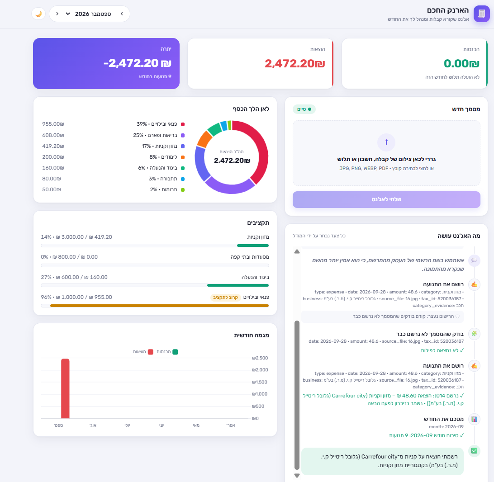
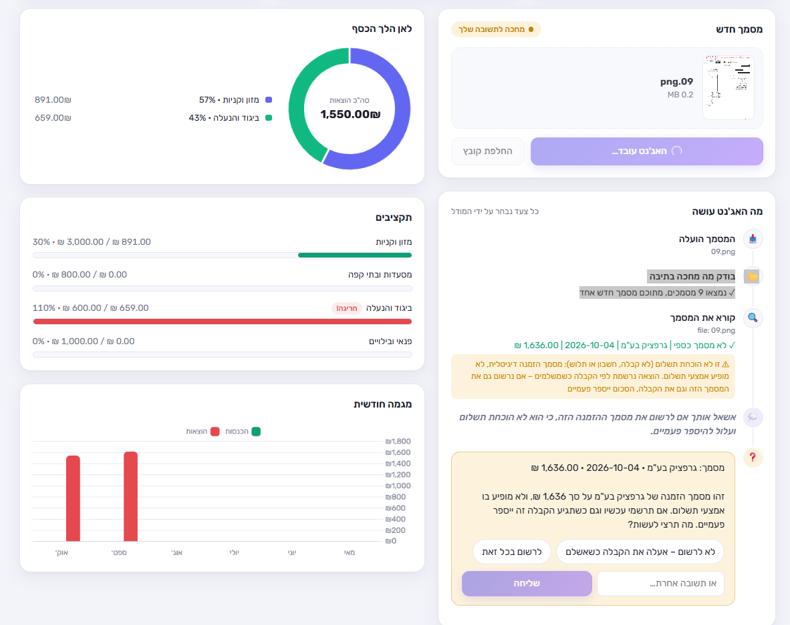
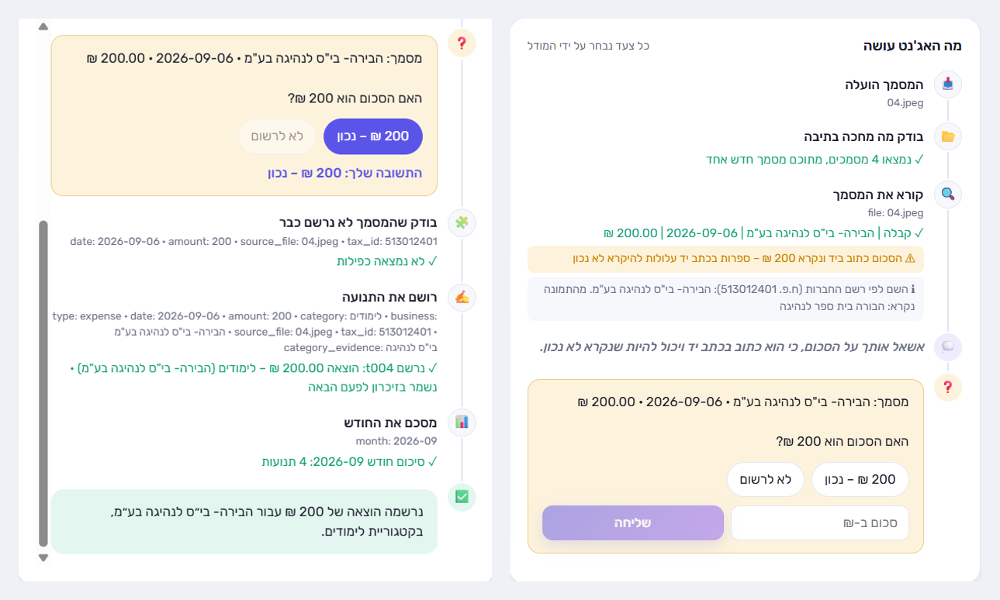
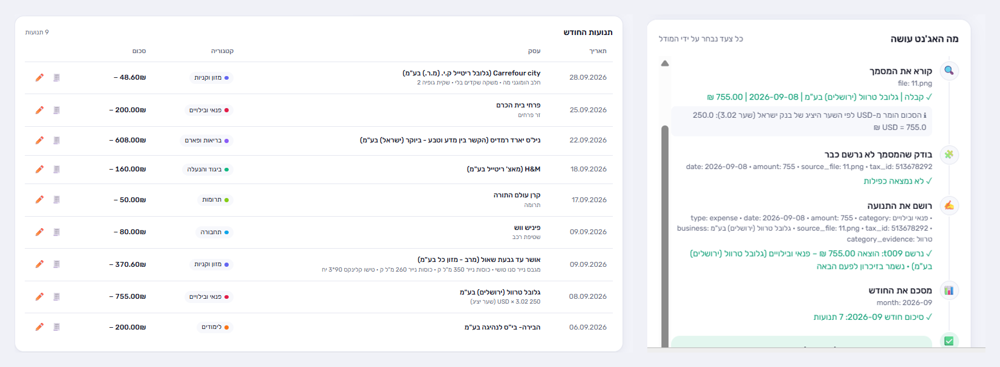
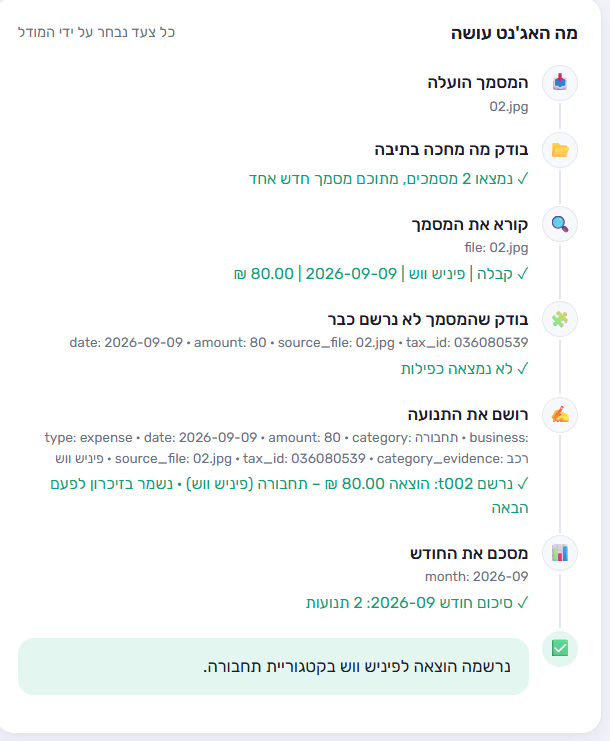
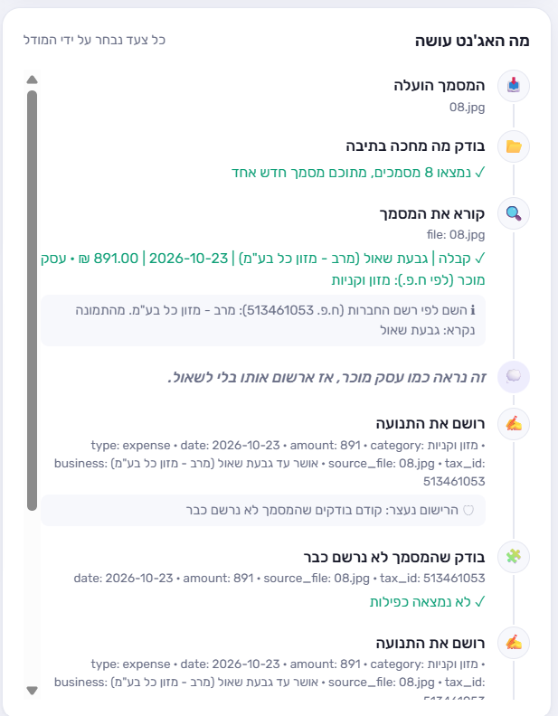
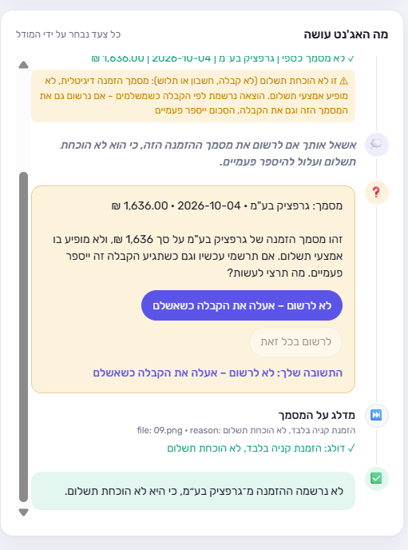
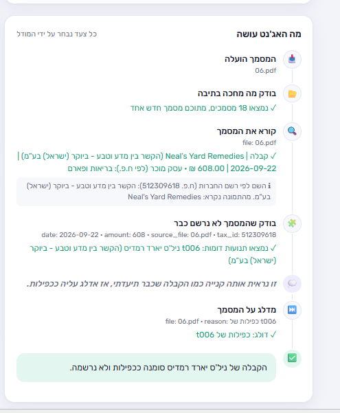
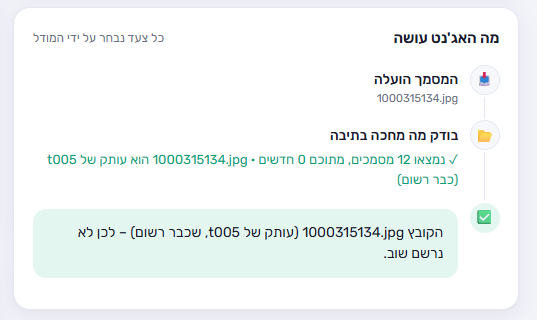

# אג'נט הוצאות והכנסות מצילומי קבלות

## בקצרה

**הבעיה:** כדי לדעת לאן הולך הכסף בכל חודש צריך להקליד כל קבלה לטבלה: סכום, תאריך, עסק וקטגוריה. זו עבודה משעממת, ולכן רוב האנשים מוותרים עליה. ההתראה על חריגה מהתקציב מגיעה מאוחר מדי, כשמסתכלים על דף הבנק.

**למה בחרתי בה:** זו בעיה אמיתית שלי, יש לי קבלות אמיתיות לבדוק עליהן, והיא מתאימה לאג'נט ולא לתוכנה רגילה. כל קבלה שונה: צילום מטושטש, כתב יד, שם עסק לא מוכר, אותה קבלה פעמיים, תלוש משכורת במקום קבלה. בכל מסמך צריך להחליט מה לעשות, ולא רק לבצע רצף קבוע של פעולות.

**מה האג'נט עושה:** מקבל צילומים (או PDF) של קבלות, חשבונות ותלושי משכורת, וקורא כל מסמך בעזרת מודל ראייה. הוא מחליט לבד אם זו הוצאה או הכנסה ולאיזו קטגוריה היא שייכת, ובודק שהמסמך לא נרשם כבר. כשמשהו לא ודאי (שנה או סכום בכתב יד, שם עסק חסר, קטגוריה לא ברורה) הוא שואל במקום לנחש – ומציע את התשובה הסבירה ככפתור. עסק שכבר זיהה, הוא זוכר לפעם הבאה. בסוף הוא מציג סיכום של כל חודש שנרשם בו משהו (הכנסות, הוצאות לפי קטגוריה ויתרה) ומתריע על חריגה מהתקציב.

המודל בוחר בעצמו איזה כלי להפעיל ומתי (function calling), ואין בקוד סדר פעולות קבוע. פייתון מבצע את הכלים, מחשב את כל הסכומים ועוצר פעולות שאסור לעשות, כמו רישום של קבלה בלי לבדוק קודם שהיא לא נרשמה כבר.

---

## התקנה והרצה

**דרישות:** Python 3.12 ומפתח API של OpenAI. המפתח לא נמצא ב-repo – כל אחד משתמש במפתח שלו. עלות: בערך סנט אחד למסמך.

**1. הורדת הפרויקט**
```
git clone https://github.com/YehuditCodes/receipt-agent.git
cd receipt-agent
```

**2. סביבה וספריות**
```
python -m venv .venv
.venv\Scripts\activate
pip install -r requirements.txt
```
ב-Mac/Linux, במקום השורה השנייה: `source .venv/bin/activate`

**3. מפתח API** – במשתנה סביבה, לא בקוד:
```
setx OPENAI_API_KEY "sk-..."
```
במקום `sk-...` שמים את המפתח. אחרי `setx` צריך לפתוח טרמינל חדש. ב-Mac/Linux: `export OPENAI_API_KEY="sk-..."`

**4. הרצה בדפדפן (מומלץ)**
```
python web_app.py
```
נפתח http://127.0.0.1:8000, ושם מעלים קבלות.

או בטרמינל, על הקבצים שבתיקייה `inbox/` (jpg, jpeg, png, webp, pdf):
```
python main.py
```

- **לנסות מייד:** בתיקייה `samples/` יש 16 מסמכים אמיתיים (פרטים אישיים הושחרו) – ראו [samples/README.md](samples/README.md). בדפדפן מעלים אותם אחד אחד, בכל סדר; בטרמינל מעתיקים אותם ל-`inbox/`.
- **בדפדפן** מעלים מסמך אחד בכל פעם (גרירה, בחירת קובץ או Ctrl+V). השאלות מגיעות ככפתורים, ותאריך או סכום מוקלדים בשדה שמקבל רק ערך תקין.
- **בטרמינל** מקלידים את מספר האפשרות. האפשרות האחרונה תמיד "אחר – אקליד בעצמי".
- **ריצה חוזרת ממשיכה מאיפה שעצרה:** מה שכבר נרשם או דולג לא מטופל שוב, גם אם אותו קובץ הועלה שוב בשם אחר.
- הנתונים נשמרים מקומית בתיקייה `data/`: `transactions.json` (התנועות), `memory.json` (עסקים שנלמדו), `skipped.json` (מסמכים שהוחלט לא לרשום) ו-`read_cache.json` (קריאות של תמונות, כדי לא לשלם פעמיים על אותה תמונה). `data/` ו-`inbox/` לא עולות ל-GitHub, כי יש בהן פרטים אישיים.
- קטגוריות, תקציבים, מודלים ומגבלות מוגדרים כולם ב-`config.py`.
- **בדיקות:** `pytest` מריץ 23 בדיקות לחלק של פייתון – אימות ערכים, כפילויות, סיכום חודשי והשומרים שעוצרים את המודל. בלי API ובלי עלות, על נתונים זמניים.
- מסמך שכבר נקרא לא עולה שוב כסף: הקריאה נשמרת ב-`read_cache.json`.

---

## הדגמה

צילומי מסך מריצה אמיתית בדפדפן על המסמכים שב-`samples/`, מנתונים ריקים.

**הדשבורד אחרי ספטמבר:** כל תנועה נרשמה על ידי האג'נט, וההוצאות מחולקות לפי קטגוריה ותקציב.



**חריגה מהתקציב** (מימין: האג'נט עוצר על מסמך שאינו קבלה ושואל אם לרשום אותו):



**סכום בכתב יד:** האג'נט לא סומך על הקריאה – מזהיר, שואל, ורק אחרי האישור רושם (ההמשך משמאל):



**קבלה בדולרים:** הסכום מומר לפי השער היציג של בנק ישראל, והמקור נשמר ומוצג בטבלה:



עוד החלטות של האג'נט:

| | |
|---|---|
| <br>קבלה שצולמה לרוחב: מסובבת, והקטגוריה נבחרת לפי "שטיפת רכב" – בלי שאלה | <br>עסק מוכר לפי ח.פ. – נרשם מהזיכרון בלי שאלה |
| <br>הזמנה, לא קבלה – שאלה, ודילוג | <br>אותה קבלה כ-PDF – מזוהה ככפילות ומדולגת |
| <br>עותק של קובץ שכבר נרשם – מדולג בלי לקרוא אותו | |

---

## אופן החשיבה – בקצרה

- **בחירת המודלים לפי מדידה, לא לפי ניחוש.** בדקתי את שני המודלים על 11 מסמכים אמיתיים. `gpt-4o-mini`, המודל שהמטלה ממליצה עליו, טעה בסכום ב-4 מתוך 5 צילומי טלפון, ומתמונה מטושטשת הוא המציא סכום. `gpt-5.4-mini` קרא נכון את כל הסכומים, ועל התמונה המטושטשת הוא סירב לנחש. גם בלולאת האג'נט `gpt-4o-mini` הפר כללים: הוא דילג על בדיקת כפילות וניחש שם עסק. לכן בשני המקומות נבחר `gpt-5.4-mini`.
- **סט בדיקה עם תשובות ידועות** (`evals/`, 20 מסמכים): 10 מהם לא נבדקו עד שסיימתי את הכוונון, כדי לוודא שהשיפורים לא "למדו את המבחן". המדד החשוב הוא "שגוי בשקט": ערך שנקרא לא נכון ואין עליו אזהרה, ולכן היה נרשם בלי שאלה. בבדיקה האחרונה סוג המסמך, הסכום והח.פ. נקראו נכון בכל 20 המסמכים.
- **הפרומפט אחראי על שיקול הדעת, והקוד אחראי על הגבולות.** המודל מחליט מה לעשות, על מה לשאול ואיזו קטגוריה לבחור. את כל החישובים עושה פייתון. בקוד יש 10 בדיקות שמסרבות לפעולה אסורה ומחזירות למודל הסבר, והמודל מחליט מה לעשות הלאה. כל בדיקה נוספה בגלל טעות שראיתי בריצה אמיתית, למשל:
  - המודל דילג על בדיקת כפילות ורשם קבלה פעמיים ← אין רישום בלי בדיקת כפילות.
  - המודל "סיים" אחרי 2 מתוך 15 מסמכים ← בסוף הריצה פייתון בודק שלא נשכחו קבצים.
  - חנות טלפונים נרשמה כ"פנאי" בלי שאלה ← עסק חדש נרשם בלי שאלה רק אם יש במסמך מילה שמראה את הקטגוריה.
- **הריצות שינו את העיצוב.** בריצה על 21 מסמכים האג'נט שאל בערך 15 שאלות, וחלקן היו מבלבלות. אז עברתי לטיפול במסמך אחד בכל פעם וניסחתי את השאלות ברור יותר. בריצה הבאה נשארה שאלה אחת, והיא הייתה מוצדקת.

הפירוט המלא נמצא ב-[docs/DESIGN.md](docs/DESIGN.md#אופן-החשיבה): כל 10 הבדיקות, מה השתנה בעקבות כל ריצה, וטיפול בשגיאות.

---

## רכיבי האג'נט – איפה כל דרישה בקוד

| דרישה מהמטלה | איך זה ממומש | איפה |
|---|---|---|
| **קבלת מטרה** | ההנחיות למודל מתחילות במטרה: לטפל בכל מסמך חדש, לרשום נכון, לשאול כשלא ודאי ולסכם. אין בהן סדר פעולות | [`SYSTEM_PROMPT`](agent.py#L23) ב-`agent.py` |
| **קבלת החלטות** | בכל צעד המודל בוחר את הכלי הבא לפי מה שראה עד עכשיו. לפני החלטה (לשאול, לדלג, לבחור קטגוריה) הוא כותב למה, וזה מוצג על המסך | [`_loop`](agent.py#L621) ב-`agent.py` |
| **שימוש בכלים** | שבעה כלים: רשימת מסמכים, קריאה, בדיקת כפילות, רישום, דילוג, סיכום חודשי ושאלה למשתמשת | [`TOOL_DEFINITIONS`](agent.py#L136) ב-`agent.py`, `tools.py` |
| **בחינת התוצאה** | התוצאה של כל כלי חוזרת למודל: אזהרות מהקריאה, מועמדים לכפילות, סירוב של פייתון – והמודל מחליט מה לעשות איתן | [`_run_tool`](agent.py#L432) ב-`agent.py` |
| **תנאי סיום** | הצלחה: כל המסמכים החדשים נרשמו או דולגו. כישלון: מגבלת צעדים, שגיאת API או Ctrl+C – ופייתון מדווח מה נשמר ומה נשאר | [`run`](agent.py#L606), [`_not_handled`](agent.py#L546), [`_progress_report`](agent.py#L554) ב-`agent.py` |

---

## לקריאה נוספת
- **[docs/DESIGN.md](docs/DESIGN.md)** – איך זה עובד (הלולאה, הכלים וההחלטות), **אופן החשיבה** (מה נמדד ולמה, 10 הבדיקות בקוד והטעות שבגללה נוספה כל אחת), טיפול בשגיאות, מגבלות ומבנה הפרויקט.
- **[samples/README.md](samples/README.md)** – 16 המסמכים לדוגמה ומה כל אחד מראה.
